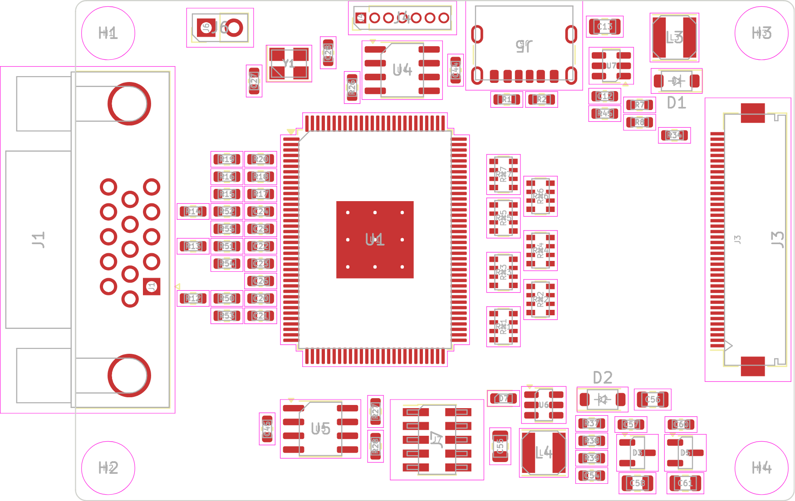
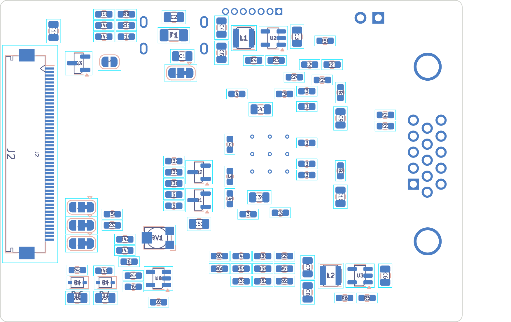

# rtd2660vga2rgb

Bo chuyển đổi **VGA → RGB TTL 24-bit** dùng scaler **Realtek RTD2660**, điều khiển panel TFT 7" 1024x600
qua connector FPC **50 pin** (kiểu AT070TN92) hoặc **40 pin**. Project KiCad 7 (mở được bằng KiCad 7/8/9).

| | |
|---|---|
| Kích thước bo | 66 x 46 mm, 4 lớp (F.Cu / GND / +3V3 / B.Cu), linh kiện hai mặt |
| Nguồn vào | 5 V qua USB-C (hoặc header 2 chân J6), khoảng 1 A |
| Linh kiện thụ động | 0603 (điện trở, tụ nhỏ), 0805 (tụ 10 µF, 22 µF, tụ 50 V) |
| Trạng thái PCB | **Đã đặt linh kiện, CHƯA đi dây** (đi dây thủ công sau) |




## Cấu trúc thư mục

- `hardware/` : project KiCad (`rtd2660vga2rgb.kicad_pro`, schematic 3 sheet, PCB, thư viện symbol/footprint RTD2660).
- `docs/` : `schematic.pdf`, `bom.csv`, hình bố trí linh kiện.
- `tools/` : script Python sinh ra schematic và PCB từ một file định nghĩa duy nhất `tools/design.py`.

## Sơ đồ khối

1. **Nguồn** (`power.kicad_sch`): USB-C 5 V, cầu chì tự phục hồi, buck 3.3 V và 1.8 V (TLV62569),
   lọc ferrite cho nguồn analog, mạch tăng áp đèn nền dòng không đổi (TPS61165).
2. **Scaler** (`scaler.kicad_sch`): cổng VGA DE-15, đầu vào analog (75R, 100R + 47 nF), RTD2660,
   thạch anh 27 MHz, SPI flash chứa firmware, EEPROM 24C16 (tuỳ chọn), header phím/LED/IR.
3. **Panel** (`panel.kicad_sch`): 7 mảng điện trở 33R nối tiếp, FPC 50 pin (J2) và 40 pin (J3),
   khoá nguồn panel, mạch bias AVDD/VGH/VGL và đệm VCOM cho panel 50 pin.

## Tương thích firmware PCB800099

Cách đấu chân được chọn theo hai sơ đồ bo RTD2660 thực tế (bo PCB800099 và một bo mini cùng họ firmware),
với mục tiêu nạp được firmware TTL có sẵn. Điều này **chưa được thử trên mạch thật**.

| Chức năng | Chân RTD2660 | Ghi chú |
|---|---|---|
| Nguồn panel | 110 | mức cao = bật (Q2 + Q1) |
| Bật đèn nền | 111 | mức thấp = bật (Q3 đảo) |
| PWM độ sáng | 102 (PWM0) | lọc RC rồi cộng vào chân FB của TPS61165 |
| Phím | 53 (ADC) | thang điện trở 0R / 1k / 2k / 3.9k / 10k với pull-up 4.7k |
| LED | 52 và 65 | |
| IR | 64 | |
| EEPROM I2C | 56 (SCL), 57 (SDA) | |
| VGA DDC + ISP | 58 (SCL), 59 (SDA) | nạp firmware qua cáp VGA |
| SPI flash | 115 CLK, 116 DI, 117 DO, 118 CS | |

Dữ liệu TTL: R0..R5 = chân 66..71, R6/R7 = 74/75, G0..G7 = 76..83, B0..B7 = 86..93,
DEN = 94, DHS = 95, DCLK = 96, DVS = 97. Firmware cần cấu hình TTL 24-bit với `_DISP_RB_SWAP | _DISP_ML_SWAP`
(giống các bản firmware gốc cho AT070TN92). Thạch anh 27 MHz (`_XTAL27000K`).

## Connector panel

- **J2 (50 pin, mặt dưới)**: theo đúng bảng chân bạn cung cấp (VLED+ 1-2, VLED- 3-4, VCOM 6/46, DVDD 7,
  MODE 8, DE 9, VS 10, HS 11, B7..B0 12-19, G7..G0 20-27, R7..R0 28-35, DCLK 37, SHLR 39, UPDN 40,
  VGH 41, VGL 42, AVDD 43, RESET 44, DITHB 47).
- **J3 (40 pin, mặt trên)**: sơ đồ chân RGB 40 pin phổ biến (LEDK 1, LEDA 2, VCC 4, R0-R7 5-12,
  G0-G7 13-20, B0-B7 21-28, CLK 30, DISP 31, HS 32, VS 33, DE 34). **Chưa xác nhận được với datasheet
  panel 1024x600 40 pin nào**, nhiều panel 40 pin 1024x600 là LVDS. Hãy đối chiếu trước khi dùng.
- Chỉ hàn một trong hai connector. J2 nằm mặt dưới vì thứ tự chân của nó ngược chiều với RTD2660;
  đặt mặt dưới thì bus RGB đi thẳng, không phải bắt chéo.
- Kiểm tra mặt tiếp xúc của cáp FPC (footprint Hirose FH12 là loại tiếp xúc dưới).
- Jumper hàn: JP1 MODE (mặc định H = DE mode), JP2 SHLR (H), JP3 UPDN (L), JP5 DITHB (L).

## Cần chỉnh theo datasheet panel của bạn

| Thông số | Mặc định | Linh kiện |
|---|---|---|
| AVDD | 9.6 V | R37 (150k). AT070TN92 cần 10.4 V: 162k |
| VGH | 18 V | zener D4 |
| VGL | -6.2 V | zener D6 |
| VCOM | chỉnh 1.4 đến 4.1 V | biến trở RV1 |
| Dòng đèn nền | 42 mA (JP4 hở), 131 mA (JP4 đóng) | R7, R8. I = 0.214 V / Rset |

Panel 7" 1024x600 loại 50 pin thường dùng đèn nền 9.6 V, 120 đến 140 mA.

## Những điểm chưa kiểm chứng

- PCB chưa đi dây, chưa chạy DRC. Schematic chưa chạy ERC trong KiCad (bản kicad-cli 7 không có ERC);
  netlist xuất ra đã được so khớp từng chân với `tools/design.py` (168 linh kiện, 149 net).
- Firmware không nằm trong project. Bo cần firmware RTD2660 nạp vào U4.
- Chiều PWM độ sáng có thể ngược với firmware. Nếu vậy: bỏ R10 và R47, hàn R11 để PWM trực tiếp vào CTRL.
- Sơ đồ chân TPS61165DBV, TLV62569, MT3608 lấy từ thư viện chuẩn KiCad; sơ đồ chân RTD2660 lấy từ datasheet
  Realtek rev 1.00 (2007/6). Nên đối chiếu lại với linh kiện bạn mua.
- Chân 2 của RTD2660 nối 1k lên VDD theo các bo tham khảo (datasheet ghi "NC, ref value 1K ohm").

## Gợi ý khi đi dây

- Lớp In1 là plane GND, In2 là plane +3V3 (đã có zone). Net class trong project: Default 0.15 mm,
  Rail 0.25 mm, Power 0.4 mm, via 0.5/0.25 mm.
- Bus RGB: U1 → mảng 33R → J3 đi thẳng trên lớp trên; xuống lớp dưới bằng via so le để tới J2.
- Giữ đường analog R/G/B (bên trái U1) xa hai mạch buck ở mặt dưới.
- Tụ decoupling của U1 nằm mặt dưới ngay dưới chip; pad tản nhiệt có 9 via nối GND.

## Sinh lại project

```bash
python3 tools/gen_sch.py
```

```bash
python3 tools/check_sch.py
```

```bash
python3 tools/gen_pcb.py
```

`gen_pcb.py` tạo lại PCB từ đầu và **xoá mọi đường dây đã đi**. Sau khi bắt đầu đi dây, chỉ sửa PCB trong KiCad.
